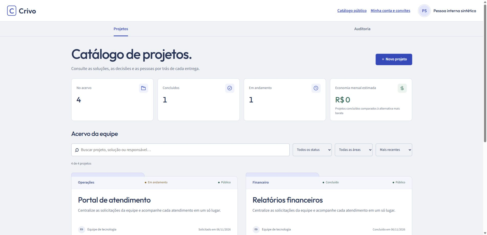
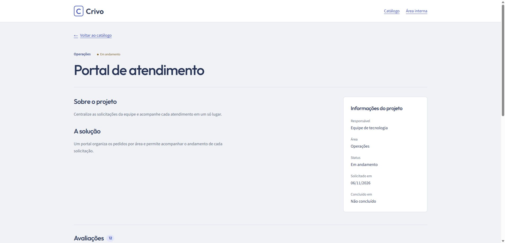

<p align="center"></p>
<h1 align="center">Crivo</h1>
<p align="center"><strong>Dê visibilidade às suas soluções. Transforme experiências em melhores decisões.</strong></p>
<p align="center">Catálogo de projetos, avaliações e gestão em uma única plataforma web.</p>
<p align="center">
  <a href="LICENSE"></a>
  
  
</p>

---

O **Crivo** conecta quem desenvolve soluções a quem usa e avalia essas entregas. Organize seu portfólio, publique projetos selecionados e reúna feedback em um espaço acessível pelo navegador.

Uma experiência de produto em nuvem para tornar projetos mais fáceis de encontrar, acompanhar e avaliar.


> As imagens mostram a interface real em uma prévia local com dados fictícios. Não representam clientes, avaliações ou resultados comerciais reais.

## Do projeto ao feedback

**Organize.** Cadastre projetos com descrição, solução, responsável, área e status. Acompanhe datas, custos e alternativas em uma área de gestão protegida.

**Publique.** Escolha quais projetos aparecem no catálogo e decida, separadamente, quando disponibilizar o link da solução. Projetos novos começam privados.

**Aprenda.** Receba notas e comentários, consulte os indicadores de avaliação e faça a curadoria do conteúdo com histórico das ações.

## Uma visão clara de cada entrega

| Recurso | O que você pode fazer |
| --- | --- |
| Catálogo público | Encontrar projetos com busca e filtros por área e status. |
| Página do projeto | Apresentar a solução, o responsável e o andamento em um link próprio. |
| Avaliações | Reunir notas de 1 a 5 e comentários, com controle de duplicidade por projeto. |
| Gestão de portfólio | Cadastrar, editar e controlar a visibilidade dos projetos. |
| Indicadores | Acompanhar entregas e estimativas de economia frente às alternativas cadastradas. |
| Curadoria | Ocultar ou reexibir avaliações, preservando o histórico. |
| Auditoria | Consultar alterações, autoria e versões anteriores dos registros. |
| Acesso por convite | Liberar a gestão somente para usuários autorizados. |

## Conheça a experiência

### Gestão em um só lugar

Projetos, indicadores e filtros para acompanhar o portfólio sem perder o contexto de cada entrega.



### Cada solução tem sua página

Apresente o projeto e reúna as experiências de quem o utiliza.



## Disponibilidade

O Crivo possui uma instância web publicada. O catálogo é público; criar uma conta não libera automaticamente a gestão, que depende de convite e autorização.

O produto atual opera com uma instância e um acervo compartilhado. Planos de assinatura, cobrança e espaços isolados para múltiplas organizações **ainda não estão implementados**.

Para solicitar acesso ou discutir licenciamento, entre em contato com [Danilo Humberto](https://github.com/danilo-humberto).

## Tecnologia

- **Interface:** HTML, CSS e JavaScript, com páginas públicas renderizadas no servidor.
- **Aplicação:** Node.js 22+ e Cloudflare Workers.
- **Dados:** PostgreSQL no Neon.
- **Autenticação:** Neon Managed Better Auth, com autorização no servidor.
- **Proteção de avaliações:** controles de envio e coordenação por Durable Objects.

## Desenvolvimento autorizado

As instruções abaixo destinam-se ao titular e a colaboradores com autorização. A disponibilidade deste repositório não concede licença para executar, adaptar ou explorar o produto.

Para uma prévia visual isolada, com Node.js 22+:

```sh
npm ci
npm run build
node tests/fixtures/curation-preview.cjs --seed-reviews
```

Abra http://127.0.0.1:4188/catalogo ou http://127.0.0.1:4188/management. Essa prévia usa dados em memória e autenticação simulada; não deve ser publicada. Encerre com Ctrl+C.

Para desenvolvimento completo, use um banco e Auth de desenvolvimento isolados e configure as variáveis a partir de `.env.example`. `npm start` gera o bundle e inicia a aplicação em http://127.0.0.1:4173. Não use credenciais nem dados de produção em testes.

Verificações locais:

```sh
npm test
npm run test:worker
npm run check:worker
```

Os testes de integração PostgreSQL exigem ambiente separado e autorização específica. Consulte a documentação técnica antes de executá-los.

## Documentação

- [Requisitos e evolução do produto](docs/plano-avaliacoes.md)
- [Arquitetura e decisões técnicas](docs/arquitetura-etapa-2.md)
- [Publicação e operação](docs/publicacao-cloudflare.md)
- [Validações e limitações conhecidas](docs/validacao-etapa-9.md)
- [Acessibilidade](docs/acessibilidade-etapa-9.md)
- [Histórico técnico do README](docs/historico-readme-2026-11-10.md)

## Propriedade e licença

**Copyright © 2026 Danilo Humberto. Todos os direitos reservados.**

Crivo é um software proprietário. Não é concedida licença geral para usar, copiar, modificar, redistribuir, comercializar ou oferecer este software como serviço. Qualquer autorização deve ser obtida por escrito com o titular, ressalvadas as hipóteses legais e os direitos aplicáveis à plataforma de hospedagem do repositório.

Consulte os termos em [LICENSE](LICENSE). Dependências de terceiros continuam sujeitas às respectivas licenças.

O selo acima identifica a licença do projeto; não é um certificado de registro. Nenhum registro no INPI é declarado neste repositório. Informações oficiais sobre registro de software estão no [INPI](https://www.gov.br/inpi/pt-br/servicos/programas-de-computador/guia-basico).
